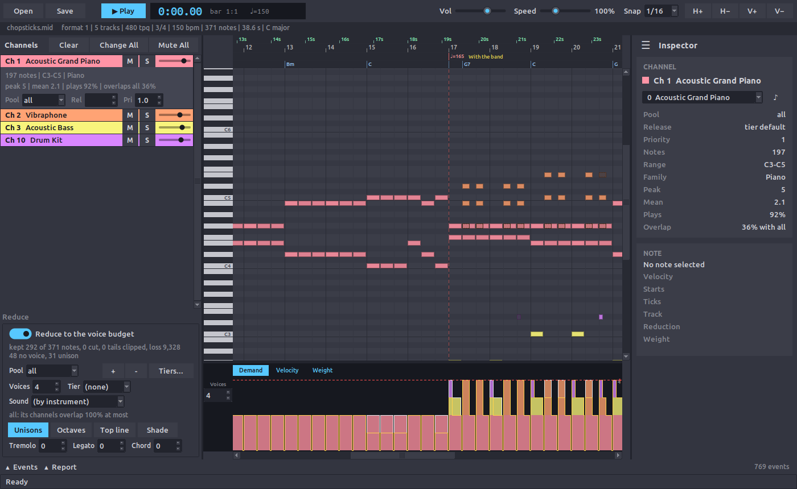
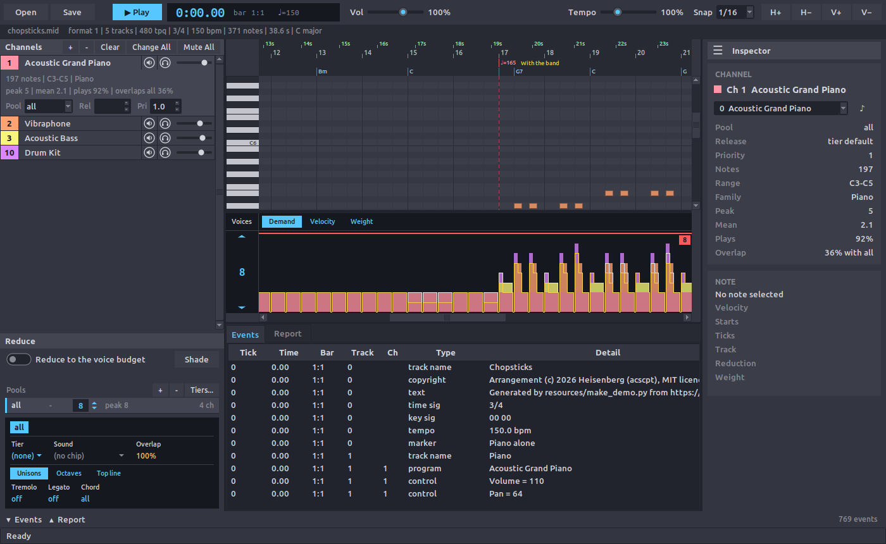

# MontyRoll

[](https://pypi.org/project/montyroll/)
[](https://pepy.tech/projects/montyroll)
[](https://www.python.org/)
[](LICENSE)
[](https://github.com/acscpt/montyroll/actions/workflows/tests.yml)
[](https://codecov.io/gh/acscpt/montyroll)

***And now for something completely MIDI***

MontyRoll reads a Standard MIDI File and shows it as a piano roll, with a voice-demand strip underneath that counts how many voices sound at each instant. Its main purpose is to reduce that demand to a voice *budget*, usually the number of channels on a target platform. The reduced arrangement plays through a [synth](#synths) such as `timidity`, and exports as a sequence of register writes for the sound chips of the platform, currently as a ZSM file for the Commander X16.

MontyRoll is written in Python and uses the standard library alone, with tkinter for the window.

The [documentation](https://github.com/acscpt/montyroll/blob/develop/docs/README.md) starts with a quick start on the demo file and goes on to every control, the plan file, and the Commander X16 export.

<a href="docs/images/demo-reduced.png"></a> <a href="docs/images/events-tab.png"></a>

## Requirements

- Python 3.10+ with tkinter (`sudo apt install python3-tk` on Debian or Ubuntu)

- Optional, for sound: a software synth on `PATH`, `timidity` recommended. See [Synths](#synths) for the alternatives and install commands.

Without a synth, everything except audio playback still works.

## Install

From PyPI, for the application alone:

```bash
pip install montyroll          # or: pipx install montyroll
```

`pipx` suits systems where pip will not install into the system Python. The package has no dependencies. The only things pip cannot provide are tkinter itself (`sudo apt install python3-tk` if `import tkinter` fails) and a synth for sound.

From the repository, which also carries the demo file and the documentation:

```bash
git clone https://github.com/acscpt/montyroll.git
cd montyroll
```

## Run

```bash
montyroll path/to/file.mid                      # installed from PyPI
python3 -m montyroll path/to/file.mid           # from a clone
python3 -m montyroll resources/chopsticks.mid   # the demo, in the clone
```

Run with no file to start empty.

The demo is an original arrangement of Chopsticks (Euphemia Allen, 1877, public domain) generated by `resources/make_demo.py`: piano alone for sixteen bars, then the repeat with vibes, bass and drums, a tempo lift at the repeat and a ritardando at the end.

## Features

**Reading a file**

The piano roll draws every note in the colour of its channel, shaded by velocity, against a bar and beat grid with a piano keyboard down the side. Above the roll, a four-row ruler gives the time in seconds, the bar numbers, the tempo changes and markers of the file, and the chord in each beat, merged into runs. A file can hold any number of tempo changes, and the seconds row stretches and compresses against the bars to follow them. Beside the roll, a row for each channel gives its instrument, its mute and solo, and its volume, and the active row adds its note count, its pitch range, its instrument family, and whether it uses pitch bend. The inspector on the right describes the active channel and the selected note, and folds away to give the roll its width. The status bar follows the pointer in musical time and names the chord and the note or drum sound under it.

Under the roll, the voice-demand strip stacks the sounding notes of each channel in the colours of the roll. Two lines over the stack count the distinct pitches, so that a unison counts once, and the distinct pitch classes, so that an octave doubling counts once too. The strip can show each note's velocity or reduction weight in place of the demand. A drawer under the roll holds two more pages: **Events** lists every event decoded, with its tick, its time, and its bar and beat, and **Report** gives the analysis as text, including the key, how many instruments play at once, and which channels rarely play together.

**Editing**

Notes are added, moved, resized, and deleted with the mouse, on a grid from whole notes down to 1/32 or with no grid at all. A selection can be given one velocity. The inspector changes the instrument of the active channel, and each row changes the volume of its own. The tempo can be set from any bar, a tempo change removed, or every tempo in the file scaled by a percentage. A save writes the original tracks back, so any event the editor does not understand is written back unchanged.

**Playing**

**Play** or `Space` plays the file through the synth, with a cursor that follows the tempo map and scrolls the roll, and the keyboard lights each key as its note sounds, in the colour of its channel. Each channel has a mute and a solo, and its instrument can be previewed in the pitch range of that channel. The master volume and the playback tempo (25-300%) change what is heard and leave the file as it is. A change to any of these during playback takes effect from the cursor.

**Reducing**

The Reduce panel fits the arrangement to the voice budget. Every note gets a weight from the priority of its channel, its velocity, its place in the texture, and whether it doubles another channel. When the budget is full, the note with the least weight gives way. Before any note competes for a voice, a pool can merge unisons, fold octave doublings, hold tremolo re-strikes as one note, close legato gaps, keep only its top line, or thin its chords.

Pools divide the channels into groups that share voices. Tiers describe the chips that the voices come from, each with its channel count, the channels reserved for other sound, and the release time of its patches. The roll stipples each dropped note, the strip shows the reduced demand with one budget line for each tier, and **Play** plays the reduced arrangement. The tiers, the pools, and the priorities make up a plan, which is saved beside the MIDI file as a `.monty` file and loads with it. **File > Save Reduced As...** writes the result as a MIDI file of its own.

**Arranging**

Three commands on the **Edit** menu add parts to an arrangement that has voices to spare. **Split Channel into Parts...** gives each part of a channel a channel of its own. **Double Channel...** copies a channel onto a free channel at an interval, and **Echo Channel...** copies it after a delay. **+** at the head of the channel strip starts an empty part on a free channel, and **-** deletes the active channel.

**Exporting**

An export target writes the reduced arrangement for the sound chips of a platform. The Commander X16 target writes a ZSM file for the YM2151 and the VERA PSG, with a sound for each pool taken from its patch library or from the instrument of each channel, and an optional bar range and loop. Once the file is written, the target reads it back and checks it.

## Controls

| Action | Control |
| --- | --- |
| Play or stop | `Space` or **Play** on the toolbar |
| New file | `Ctrl+N` |
| Open a file | `Ctrl+O` |
| Save the file | `Ctrl+S` |
| Select every note | `Ctrl+A` |
| Clear the selection | `Esc` |
| Delete the selection | `Del` |
| Add a note on the active channel | Double-click the piano roll |
| Move a note | Drag the note |
| Resize a note | Drag its right edge |
| Add a note to the selection, or take it out | `Shift` and click |
| Zoom horizontally | `Ctrl` and the mouse wheel, anchored at the pointer |
| Scroll horizontally | `Shift` and the mouse wheel |
| Scroll vertically | The mouse wheel |
| Play from the bar or beat under the pointer | Right-click the piano roll |
| Delete a note or set its velocity | Right-click the note |
| Set the tempo from a bar | Double-click the tempo row of the ruler |
| Set, remove, or scale tempos | Right-click the tempo row of the ruler |

## Synths

MontyRoll makes no sound of its own. For playback it writes a temporary MIDI file and hands it to the first of these found on `PATH`:

- [TiMidity++](https://timidity.sourceforge.net/) (`timidity`), recommended. On Debian or Ubuntu: `sudo apt install timidity`.

- [FluidSynth](https://www.fluidsynth.org/) (`fluidsynth`), which needs a General MIDI soundfont in `/usr/share/sounds/sf2`, `/usr/share/soundfonts`, or `/usr/local/share/soundfonts`. On Debian or Ubuntu: `sudo apt install fluidsynth fluid-soundfont-gm`.

- [WildMIDI](https://github.com/Mindwerks/wildmidi) (`wildmidi`)

- `aplaymidi` from [alsa-utils](https://github.com/alsa-project/alsa-utils), used only when an ALSA synth port other than "Midi Through" exists. Midi Through is always present and plays nothing, so on its own it is not enough.

## Licence

MIT - see [LICENSE](LICENSE).
