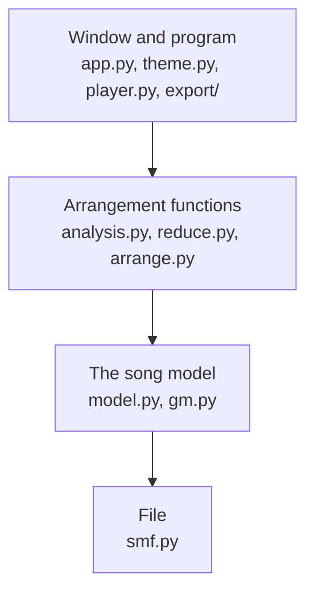
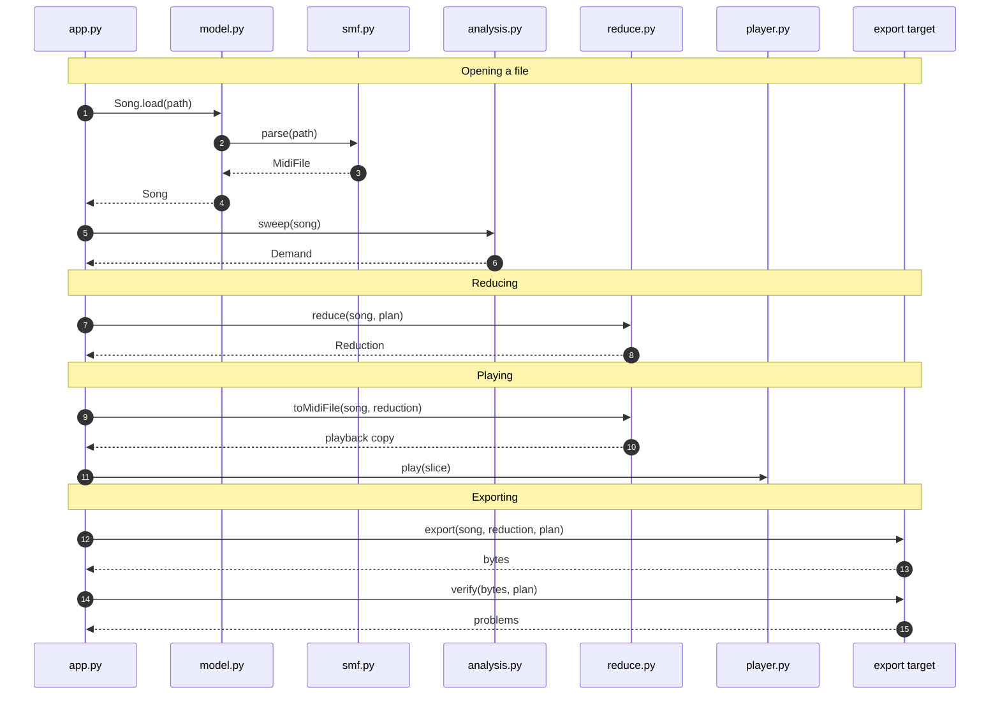
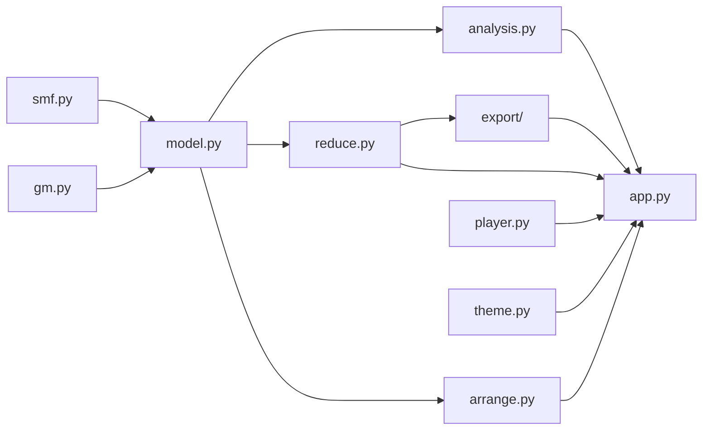

# Architecture

MontyRoll reads a Standard MIDI File and presents it as a familiar piano roll. Under the piano roll a voice-demand strip is also shown. The voice-demand strip shows how many simultaneous voices are playing at any instant. The main purpose of MontyRoll is to reduce those voices to a set voice *budget*, which is typically the number of channels available on a target platform. This budget is drawn on the same strip. Several parameters define the reduction, and these are all editable.

Edits are made to the in-memory model that is built from the notes, channels, and tempo changes of the file. New notes can be added, and each channel takes its instrument from the General MIDI instrument list.

Playback plays the arrangement through the installed synth engine (see [Installation](install.md)). An arrangement can be exported, which turns a reduction into a sequence of register writes for the sound chips of a particular hardware platform.

## Layers

MontyRoll is organised into four main layers.

- **Window and program**
  - `app.py` draws the screen and takes the mouse and the keyboard, in the colours and fonts that `theme.py` holds. Beside it sit the two ways out of the program:
    - `player.py` hands a copy of the song to a synth
    - `export/` writes a reduction for a sound chip (pluggable)

- **Arrangement functions**
  - Each function performs a specific operation on the arrangement:
    - `analysis.py` measures the voice demand, the key, and the chords
    - `reduce.py` fits the song to a voice budget
    - `arrange.py` splits, doubles, or echoes a channel

- **The song model**
  - `model.py` turns the events of the file into notes, channels, and a tempo map, and applies edits to them
  - `gm.py` holds the General MIDI names that the model gives to instruments and drum keys

- **File**
  - `smf.py` reads a Standard MIDI File into lists of events and writes lists of events back to a file

## The path of a file

A typical session opens a file, reduces it, plays the result, and exports it. The song is read once. Each later step takes the song and returns something new, so the steps repeat in any order as the plan changes.

**Opening a file**

1. The window calls `Song.load` with the path.

2. `Song.load` passes the path to `smf.parse`.

3. The parser returns a `MidiFile`: the tracks of the file as lists of events, each with an absolute tick.

4. The model pairs each note-on with its note-off to make the notes, gathers the channels with their instruments, and builds the tempo map. It returns a `Song`.

5. The window asks `analysis.sweep` for the voice demand of the song.

6. The sweep returns a `Demand`, the count of sounding notes for each stretch between two note boundaries. The window draws the piano roll, the channel rows, and the strip.

**Reducing**

7. With **Reduce to the voice budget** ticked, the window passes the `Song` and the current `Plan` to `reduce.reduce`.

8. The reducer returns a `Reduction`. The window redraws the roll from it with each dropped note stippled, and sweeps the placed notes for the strip.

**Playing**

9. The window asks `reduce.toMidiFile` for a playable copy of the reduction. With the reduction switched off, the song itself is played and this step is skipped.

10. The copy comes back as a `MidiFile` that carries the tempo map and the programs and controllers of each channel.

11. The window cuts a slice of the copy from the cursor with `Song.buildSlice` and gives it to `Player.play`. The player writes the slice to a temporary file and starts the synth on it.

**Exporting**

12. The window passes the `Song`, the `Reduction`, and the `Plan` to the `export` function of the target.

13. The target returns the bytes of the chip music file, and the window writes them to disk.

14. The window hands the same bytes back to the `verify` function of the target.

15. `verify` returns a list of problems, which is empty for a sound file. The status bar shows the result.

## Modules

The four layers map onto nine modules and the `export/` subpackage. An arrow runs from a module to each module that imports it.

| Module | Role |
| --- | --- |
| `smf.py` | Reads a Standard MIDI File into a `MidiFile` and writes one back. Handles formats 0 and 1, running status, meta events, and sysex. |
| `gm.py` | Holds the General MIDI names for programs, instrument families, and drum keys. |
| `model.py` | Builds a `Song` from a `MidiFile` and applies edits to it. Converts between ticks, seconds, and bars through the tempo map. |
| `analysis.py` | Measures a `Song`: the voice demand over time, the doubling between channels, the key, and a chord for each beat. |
| `reduce.py` | Fits a `Song` to a `Plan` and returns a `Reduction`. Reads and writes the plan file. |
| `arrange.py` | Builds a new `MidiFile` from a `Song` with one channel split into parts, doubled, or echoed. |
| `export/` | Holds one module for each export target. `zsm.py` writes a ZSM file for the Commander X16. |
| `player.py` | Finds a synth on `PATH` and runs it on a temporary copy of the song. |
| `app.py` | The tkinter window: the piano roll, the channel rows, the lanes under the roll, the Reduce panel, the inspector, the drawer, and the menus. |
| `theme.py` | Holds the colours and the fonts that `app.py` applies, and paints the switch and the sliders as images. |

## Design considerations

Two kinds of decision run through the code. Constraints hold everywhere and limit what any part can do. Behaviours are shared by several parts and are described once here.

### Constraints

- **The standard library is the only dependency.**
  - tkinter draws the window, and a synth found on `PATH` makes the sound.
  - A clone runs with `python3 -m montyroll`.

- **A note is a view over its events.**
  - A `Note` points at the note-on and the note-off it came from, and an edit writes back into those two events.
  - A save serialises the tracks the file arrived with, so every other event leaves as it came.

- **A reduction is a result.**
  - `reduce.reduce` returns a `Reduction` and leaves the `Song` as it was.
  - The roll, the strip, playback, and the export read that one result.

- **Every import points down the stack.**
  - The arrangement functions take a `Song` and return plain data.
  - `app.py` is the one module that imports tkinter.

- **Time is kept in ticks.**
  - Analysis and reduction work in ticks, which are exact.
  - Seconds come from the tempo map, and frames appear at the export.

### Behaviours

- **Results are computed on demand.**
  - The window caches the demand, the chords, the reduction, and the report.
  - An edit clears all four, and each is rebuilt when something next draws it.

- **A live change restarts the synth.**
  - A synth plays a file from its first event. A mute, a volume, or a speed change therefore stops it and starts it again from the cursor.
  - `Song.buildSlice` builds the copy for the restart, with the tempo, the programs, and the controllers in force at that tick.
  - A wait of 300 ms groups a dragged slider into one restart.

- **A muted channel plays at volume zero.**
  - Its notes stay in the playback copy.
  - `timidity` skips silence at the start of a file, and the retained notes keep its clock in step with the cursor.

- **Channels count from 1 on the screen.**
  - The code uses 0 to 15. The rows, the inspector, the status bar, and the plan file use 1 to 16.
  - Ch 10 is the General MIDI drum channel, and the unison and octave merges pass its notes through.

- **An error carries its source.**
  - The parser and the plan loader raise `ValueError` with the path and the reason.
  - The window shows the message in a dialog. A plan that a tier cannot hold appears on the result label.

### Implementation specifics

- **Weights.**
  - Every note gets a weight before any note is dropped. The weight is the product of four factors: channel priority, velocity, place in the texture, and a discount for a doubling.
  - The [Reference](reference.md#note-weight) gives the value of each factor.

- **Allocation.**
  - A pool is a set of channels that share a number of voices, and stealing happens inside one pool.
  - At a full pool the allocator multiplies each weight by the ticks the note has left, and the smallest product gives way.
  - A new note that weighs less than everything that plays stays out.

- **Release tails.**
  - A tier describes one chip, and it gives the time a voice needs to fade after its note ends.
  - The allocator holds the voice for that long, converted from milliseconds to ticks at the tempo in force.
  - A voice taken during its release counts at a quarter of the weight of its note.

- **Frames.**
  - The Commander X16 export rounds the absolute time of each event to a frame, at 60 frames per second.
  - Delays are taken between rounded frames, so the timing error stays within half a frame over any length of music.

- **Verification.**
  - The target reads its own output back through a decoder that was written separately from the writer.
  - A structural check and a model of both chips then run over the decoded stream.

- **The plan file.**
  - The plan holds the tiers, the pools, the priorities, the releases, the sounds, and the export range.
  - It is a JSON file with the suffix `.monty` beside the MIDI file. It names its MIDI file, or embeds it with a SHA-256 checksum.

## Further reading

- [Overview](overview.md) - what a reduction is, and how weights, pools, and tiers shape it.

- [Reference](reference.md) - every control, the fields of the plan file, and the tables of the Commander X16 target.

- [Usage](usage.md) - the steps for each task, from a first look at a file to an export.

- [Worked example: Commander X16](examples/x16-zsm.md) - one export followed from the demo file to the emulator.
