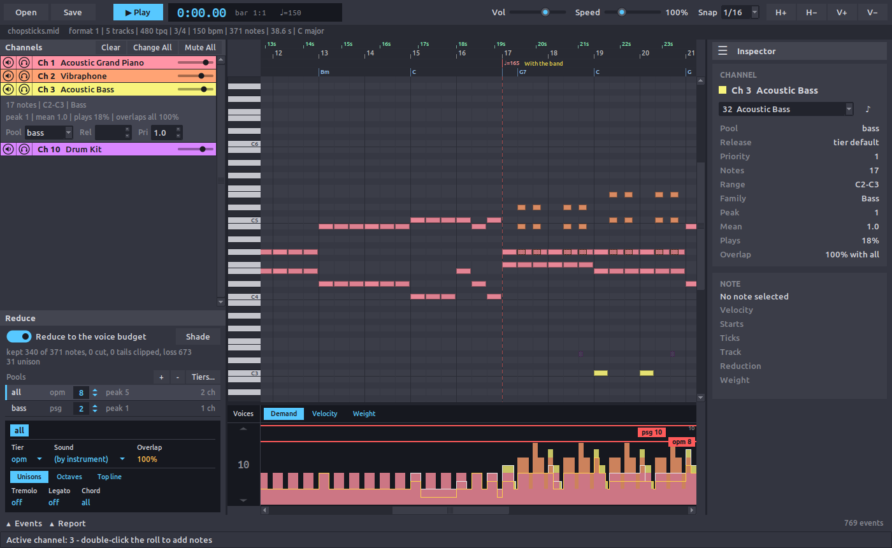

# Worked example: Commander X16

The Commander X16 has two sound chips. The YM2151 is an FM synthesiser with 8 channels, and the VERA PSG is a programmable sound generator with 16. A program on the X16 plays music from a ZSM file. The file is a stream of register writes for both chips, and the ZSMKit player sends them one frame at a time.

This example takes the demo file, `resources/chopsticks.mid`, from MIDI to a ZSM file that plays in the X16 emulator:

1. Open the demo file and describe the two chips as tiers.

2. Divide the channels between the chips with pools.

3. Check the reduction by eye and by ear, and save the plan.

4. Export the ZSM file.

5. Play the file in the emulator.

The result is `chopsticks.zsm`, a 3 KB file that plays for 39 seconds. The piano and the vibraphone play on the YM2151, and the bass plays on the VERA PSG.

## Requirements

- A clone of MontyRoll that runs, as the [installation guide](../install.md) describes.

- The X16 emulator, `x16emu`, release R44 or later, from the [x16-emulator releases page](https://github.com/X16Community/x16-emulator/releases).

- `MELODIUS.PRG` from the [Melodius releases page](https://github.com/mooinglemur/melodius/releases). Melodius is a music player for the X16 that plays ZSM files.

## Open the demo in a working directory

A working directory keeps the MIDI file, the plan, and the export together, and the emulator later reads the same directory as its disk. Run these commands from the clone:

```bash
mkdir ~/x16-demo
cp resources/chopsticks.mid ~/x16-demo/
python3 -m montyroll ~/x16-demo/chopsticks.mid
```

The window opens with four channel rows: Acoustic Grand Piano on Ch 1, Vibraphone on Ch 2, Acoustic Bass on Ch 3, and the drum kit on Ch 10. The right end of the toolbar reads:

```text
chopsticks.mid   fmt 1 | 5 trk | 480 tpq | 3/4 | 150 bpm | 371 notes | 38.6s | C major
```

## Describe the two chips

A tier describes one chip to the reducer, and the Commander X16 target has a preset for its two.

1. On the Reduce panel, click **Tiers...**.

2. Click **Commander X16**. Two rows appear: `opm` with 8 channels, and `psg` with 16, of which 4 are reserved.

3. Click **OK**.

The **Tier** box on the Reduce panel now offers `(none)`, `opm`, and `psg`. The name `opm` is the YM2151, and `psg` is the VERA PSG.

## Give the bass a pool on the PSG

A pool is a set of channels that share voices, and each pool draws its voices from one tier. The file opens with a single pool, `all`, that holds every channel. A second pool moves the bass onto the PSG.

1. Click **+**. A line for `pool 2` appears in the pools table, selected.

2. Double-click `pool 2` in the table, type `bass`, and press Return.

3. Set the voices of `bass` in the table to 2.

4. Set **Tier** to `psg`.

5. Click the `Ch 3` row and set **Pool** under it to `bass`.

**Overlap** on the display under the table now reads `-`, as the pool has a single channel.

## Put the keyboards on the YM2151

The first pool, `all`, still holds the piano and the vibraphone, and it takes the YM2151. The Commander X16 target plays pitched sounds, so the drum kit leaves the reduction.

1. Click `all` in the pools table on the Reduce panel.

2. Set **Tier** to `opm`.

3. Click the `Ch 10` row and set **Pool** under it to `(none)`.

Two red lines now cross the strip, one for each tier, labelled `opm 8` and `psg 10`.

## Check the reduction

Switch on **Reduce to the voice budget**. The result label under the switch reads:

```text
kept 340 of 371 notes, 0 cut, 0 tails clipped, loss 673
31 unison
```

Every note of the three pitched channels has a voice. The 31 `unison` notes are vibraphone notes that double the piano at the same pitch, which one voice plays for both. The roll draws those 31 stippled, together with the 61 drum notes that are out of the reduction.



With a synth installed, **Play** plays the three pitched channels. The notes are the ones that the X16 plays, on General MIDI instruments in place of the chip sounds.

## Save the plan

Choose **File > Save Plan**. The status bar reads `Saved plan to` and the path of `chopsticks.monty`, a new file beside the MIDI file. The plan holds the tiers and the pools, so the next session starts where this one ends.

## Export the ZSM file

1. Choose **File > Export Commander X16 (ZSM)...**.

2. In the dialog, go to `~/x16-demo`.

3. Enter `chopsticks.zsm` and save.

The status bar reads `Exported` and the path, followed by:

```text
3 KB, 1 banks, 39 s, peak 5 OPM and 1 PSG voices, 279 notes, no problems
```

The 279 notes are the 340 kept notes less the 61 drum notes. `no problems` is the verdict of the checks that the target runs on the file after writing it.

## Play the file on the X16

Copy Melodius into the directory and start the emulator there:

```bash
cp /path/to/MELODIUS.PRG ~/x16-demo/
x16emu -fsroot ~/x16-demo -prg ~/x16-demo/MELODIUS.PRG -run
```

Melodius lists the files in the directory. Move to `chopsticks.zsm` with the Down key and press Enter.

The piano starts, and the meters for YM2151 channels 1 to 4 move with it. After 19 seconds the bass enters on PSG channel 1, and the vibraphone joins on the YM2151.

## The result

The directory `~/x16-demo` holds three files from the example:

| File | Contents |
| --- | --- |
| `chopsticks.mid` | The demo, byte for byte as it was copied |
| `chopsticks.monty` | The plan: two tiers and two pools |
| `chopsticks.zsm` | The music as register writes for the two chips |

## How it works

The export turns each stage of the plan into something the chips can play.

### Voices to channels

The reducer gives each placed note a voice number inside its pool. The target maps the voices of the `all` pool onto YM2151 channels and the voices of the `bass` pool onto PSG channels. The piano and the vibraphone peak at 5 voices together, so 5 of the 8 YM2151 channels sound, and the bass uses 1 PSG channel.

### Instruments to sounds

Both pools leave **Sound** at `(by instrument)`, so each channel takes its sound from its General MIDI program. On the YM2151 the piano and the vibraphone both take the `piano` patch. On the PSG the Acoustic Bass takes a held triangle wave. The [reference](../reference.md#commander-x16-zsm-target) has the full mapping for both chips.

### Ticks to frames

A ZSM file counts time in frames of one sixtieth of a second. The target converts the tick of each event to an absolute time through the tempo map and rounds that time to a frame. The demo changes tempo at bar 17 and slows over its last bars, and the frames follow.

### The checks

After the file is written, the target reads it back with a decoder and runs a model of both chips over the stream. The checks confirm that each YM2151 channel has its whole patch before its first note and that every channel is silent after the last event.

## Common pitfalls

- **A pool with no tier.** The export stops with `has no tier, so its voices have no chip`. Every pool that holds channels needs a tier of the target.

- **More voices than the chip has.** With the `all` pool at 9 voices the result label reads `plan refused: tier opm: pools want 9 voices, 8 available`. The pools of a tier share its channels less the reserved ones.

- **Full level with many voices.** Voices at full level add together on the output. A value of **Vol** near 60% suits a file that uses most of the voices.

## Further reading

- [Export a section and loop it](../usage.md#export-a-section-and-loop-it) - a bar range and a loop bar for music that repeats.

- [Commander X16 (ZSM) target](../reference.md#commander-x16-zsm-target) - the patches, the PSG waveforms, the instrument mappings, and every check on the output.

- [Architecture](../architecture.md) - the path from the song through the reducer to an export target.
