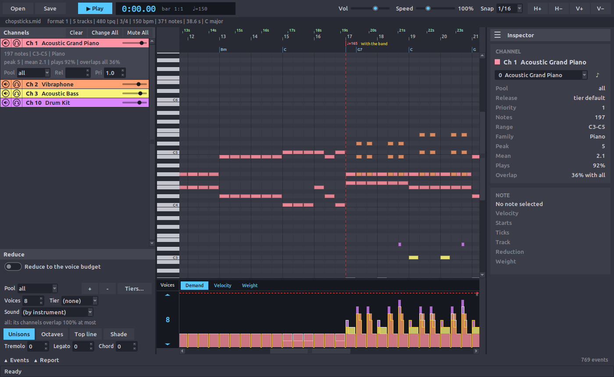

# Quick start

Firstly ensure MontyRoll is installed (see [Installation](install.md) for details). This quick start uses the demo file `resources/chopsticks.mid`, which comes with a clone of the repository and can also be downloaded from it directly.

In the demo file a piano plays for sixteen bars, and at bar 17 a vibraphone, a bass, and a drum kit join in. From that bar up to eight voices play at once.

This quick start shows how to open the file, where the eight voices come from, and how to reduce the arrangement to a budget of four simultaneous voices.

## Open the demo file

Open the demo file from the cloned repository with:

```bash
cd montyroll
python3 -m montyroll resources/chopsticks.mid
```

The window opens with the channels on the left, the piano roll in the middle, and the inspector on the right. Each channel has a row that names its instrument:

1. Acoustic Grand Piano on Ch 1
2. Vibraphone on Ch 2
3. Acoustic Bass on Ch 3
4. Drum Kit on Ch 10

To the right is the piano roll, which draws every note colour coded according to its channel.

Under the roll sits the voice-demand strip. The strip is a stacked view, also colour coded by channel, and its height at any bar is the number of notes being played simultaneously.

Note that the stack is low while the piano plays alone and climbs at bar 17 when the rest of the instruments begin to join in.



The dashed line along the top of the strip is the voice *budget*, the number of voices that the arrangement is allowed to use. It automatically starts at the peak of the file, which for this file is 8.

## Reduce to four voices

The main purpose of MontyRoll is to allow a multi-voice MIDI arrangement to be trimmed to a smaller number of simultaneous voices, which is useful for playback on hardware with a limited set of channels.

The voice budget is the number under **Voices**, just to the left of the demand strip.

1. Set **Voices** to 4, with the arrows beside the number or by double-clicking it and typing 4. The budget line drops, and a red wash marks each stretch where the stack rises above it.

2. Switch on **Reduce to the voice budget** on the Reduce panel, under the channel rows.

The strip now stays at or under the line, and the roll stipples every note that the reduction drops.


The result label under the switch counts what happened:

```text
kept 292 of 371 notes, 0 cut, 0 tails clipped, loss 9,328
48 no voice, 31 unison
```

The second line gives a reason for each of the 79 dropped notes. The 31 `unison` notes are vibraphone notes that double the piano at the same pitch, so one voice plays both. The 48 `no voice` notes arrived while all four voices held notes that weigh more. Of those 48, 41 belong to the drum kit.

## Hear the result

Press **Play** (or `Space`) to hear the reduction from the first bar. To hear the original again switch off **Reduce to the voice budget** and press **Play** to allow easy comparison.

## Choose what gives way

Every note is assigned a weight, and at a full budget the note with the least weight gives way. **Pri**, under the active channel's row, multiplies the weight of every note on that channel, so it decides which channels keep their notes.

Click the Ch 10 row and set **Pri** under it to 2.0. The label still counts 48 `no voice` drops, as the budget is still four voices, but the drum kit now loses 10 notes where previously it lost 41. The vibraphone gives way in its place, and its stippled notes show on the roll.

## Where to go next

- [Usage](usage.md) for pools, which give a group of channels voices of their own, and tiers, which describe the chips of a target.

- [Worked example: Commander X16](examples/x16-zsm.md) for the same demo file exported as chip music and played in an emulator.

- [Overview](overview.md) for how a note gets its weight and what a reduction keeps.

- [Reference](reference.md) for every control on the window and every field of the plan file.

- [Troubleshooting](troubleshooting.md) if the window does not open or **Play** makes no sound.
